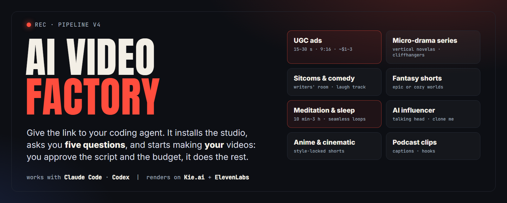
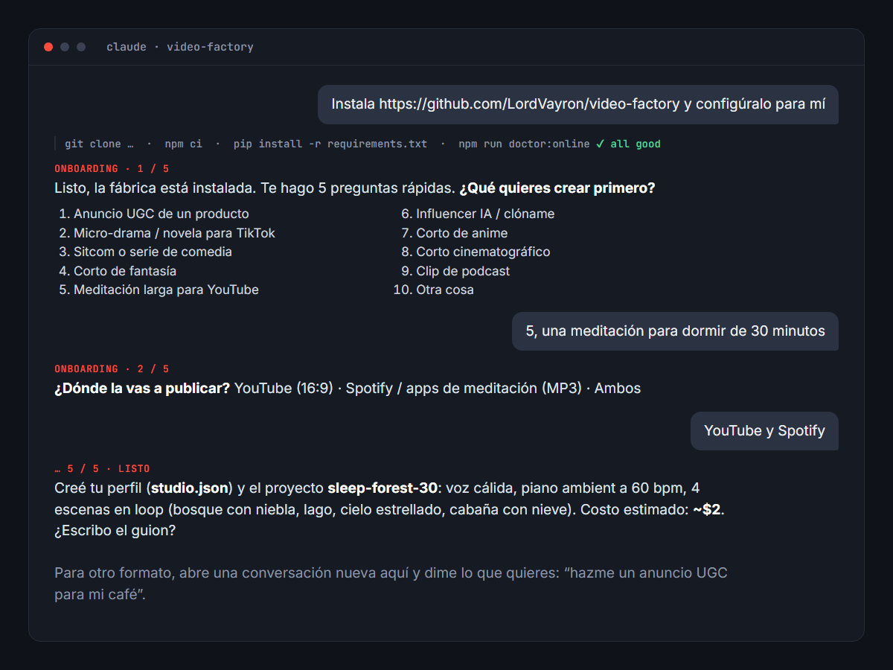
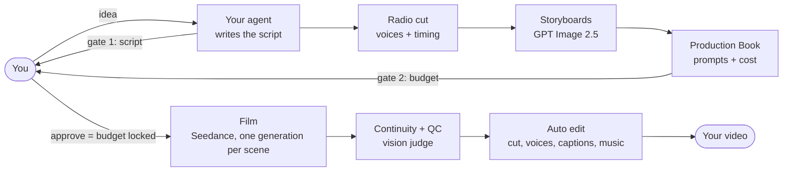

<p align="center">
  
</p>

<p align="center">
  <b>An AI video studio that your coding agent installs and runs for you.</b><br>
  UGC ads, micro-drama series, sitcoms, fantasy shorts, hour-long meditations and more,<br>
  written and directed by Claude Code or Codex, rendered on APIMart, Kie.ai and ElevenLabs.
</p>

<p align="center">
  
  
  
  
  
</p>

---

**Website:** https://videofactory-tv.vercel.app · watch the pilot episode made with it.

## Install it in one message

Open **Claude Code** or **Codex** and paste:

```text
Install https://github.com/LordVayron/video-factory and set it up for me.
```

Your agent clones the repo, installs everything it needs, checks your machine, and then asks you **five quick questions**: what you want to create, where you'll publish it, the language and tone, whether you have your own brand or characters, and your budget per video. It creates your profile and your first project, and you're ready to make your first video.

<p align="center"></p>

> **Instalación en español:** abre Claude Code o Codex y escribe *"Instala https://github.com/LordVayron/video-factory y configúralo para mí"*. Tu agente instala todo, te hace 5 preguntas y deja listo tu primer proyecto.

You need [APIMart](https://apimart.ai) or [Kie.ai](https://kie.ai) for images and video (both is best: the engine compares their live prices and sends every job to the cheaper one, APIMart first; Kie also makes the music), and [ElevenLabs](https://elevenlabs.io) (voices). You paste the keys into a local `.env` file yourself; they never leave your machine.

## What you can make

| Format | Length | Typical cost | How |
|---|---|---|---|
| **UGC product ads** | 15–30 s, 9:16 | $1–3 | creator-style review with your product shots |
| **Micro-drama series** (vertical novelas) | 60–120 s episodes | $2–5 per episode | locked cast, cliffhangers, captions |
| **Sitcoms and comedy series** | 40–60 s episodes | $2–5 per episode | writers' room, radio cut, laugh track, series intro |
| **Fantasy shorts** | 30–90 s | $2–6 | epic or cozy, style-locked |
| **Meditation, sleep and ambient** | 10 min – 3 h, 16:9 | about $2 for 30 min | seamless looping scenes, music bed, voice-over with real pauses, plus an MP3 |
| **AI influencer / clone me** | 15–60 s | $1–4 | your own face and voice only, with consent |
| **Product launch films** | 30–35 s, 16:9 | $4–8 | from your landing page: interview, three concepts, one continuous story in storybook, anime, photoreal or your own style, narration, composited brand and CTA |
| **Anime, cinematic, podcast clips** | 15–60 s | $1–5 | per-vertical playbooks |

Each format has a **playbook** (a "vertical DNA" file) with what makes it work, how to write it, pacing numbers, and a QC checklist. To make a different format, open a new conversation in the folder and say what you want: *"make a 20-minute sleep meditation"*, *"start a TikTok novela about a hidden inheritance"*, *"UGC ad for my coffee brand"*.

## How it works



- **One enforced path, every format.** Every video starts with seven quick questions (single or series, format, idea or from scratch, platform, cast, budget, references) and moves step by step: concept, script, cast, storyboard, Production Book, film, edit, final QC, delivery. The engine refuses a step out of order, and a Claude Code hook stops one-off scripts and undelivered files.
- **You approve the creative gates:** concept, script, cast and the Production Book (the budget), in your own words. Nothing is spent on video before that.
- **The budget is locked in code.** Once you approve the Production Book, the engine refuses any job that would go past it. Extra spend needs your explicit yes.
- **Audio first.** A "radio cut" of the voices sets every shot's length before any picture is paid for, so pacing is right on the first take.
- **One generation per scene** with all its shots, in the cheapest model that keeps quality (Seedance 2 Mini by default).
- **Automatic QC:** every take is checked for identity (faces and marks like freckles or glasses, against a locked face), jumps inside the shot, dialogue, positions, physics, light and geography; the final is checked across every cut before a delivery receipt is issued.

## For long-form: meditation, sleep and ambient

A 30-minute guided meditation costs about $2, because the picture loops:

- 3–6 scenes, each one a **seamless loop**: a GPT Image 2.5 still animated by Seedance with the first frame equal to the last (or a free slow zoom).
- A Suno music bed that ducks gently under an ElevenLabs voice-over, with pauses you control segment by segment.
- 1080p for YouTube plus an MP3 for Spotify and meditation apps, a contact sheet, and a loudness and dead-air check.
- Only the loop units and transitions are encoded; the rest is stream-copied, so **30 minutes of 1080p renders in about 5 minutes**.

## Manual install

Prefer to do it yourself? See **[docs/INSTALL.md](docs/INSTALL.md)**. In short:

```bash
git clone https://github.com/LordVayron/video-factory.git
```

```bash
cd video-factory && npm run setup
```

Then copy `.env.example` to `.env`, paste your keys, run `npm run doctor:online`, open your agent in the folder and say *"onboarding"*.

## Repository layout

```
.claude/skills/   the skills your agent follows (studio, onboarding, story-architect, cinematographer, cast, format-series, format-longform)
  studio/references/   the knowledge base: vertical playbooks, QC rubric, styles, comedy and story craft
engine/           Node CLIs that call APIMart, Kie.ai, ElevenLabs and ffmpeg (generation, budget lock, edit, QC)
bible/styles/     style sheets (UGC phone, hyperreal, anime, podcast, retro sitcom, template)
templates/        starting points: creator profile, character, set, series
bible/, series/, projects/   your own characters, shows and videos (gitignored, they stay on your machine)
AGENTS.md         house rules for any agent (CLAUDE.md imports it)
SETUP.md          step-by-step install instructions for agents
```

## Commands

| Command | What it does |
|---|---|
| `npm run doctor` | Checks tools, Python packages, keys and the repo |
| `npm run doctor:online` | Same, plus your Kie credits and ElevenLabs key |
| `npm run check` | Offline smoke tests and a secret scan |
| `npm run prices` | Live prices from APIMart and Kie, and which one runs each model |
| `npm run credits` | Your APIMart and Kie balances |

Engine CLIs (`node engine/<tool>.mjs`) are documented in [docs/ARCHITECTURE.md](docs/ARCHITECTURE.md).

## Responsible use

Make original characters and stories. Don't generate real people other than yourself (with your own photos and voice) unless they authorized it (the engine records your statement), copyrighted characters, or brands you don't own. Follow each platform's rules for AI-generated content and label it where required. Your Kie.ai and ElevenLabs usage is subject to their terms.

## Documentation

- [Install (manual)](docs/INSTALL.md)
- [Architecture and engine CLIs](docs/ARCHITECTURE.md)
- [Formats and costs](docs/FORMATS.md)
- [Security](SECURITY.md) · [Contributing](CONTRIBUTING.md) · [Changelog](CHANGELOG.md)

<p align="center"><sub>MIT licensed. Not affiliated with Anthropic, OpenAI, APIMart, Kie.ai, ElevenLabs or Higgsfield.</sub></p>
