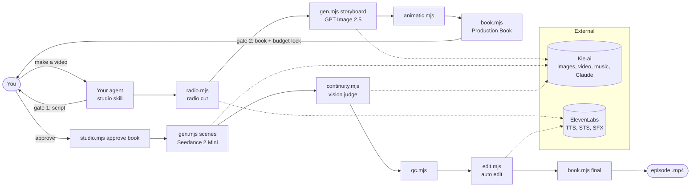

# Architecture

The factory has three layers. **Your coding agent** (Claude Code or Codex) is the director: it reads the skills, writes the script, makes creative calls and runs the engine. The **engine** (`engine/`) is plain Node.js with no framework: CLIs that read and write JSON files and call Kie.ai, ElevenLabs and ffmpeg. The **data** is files on disk: the bible, the series, and one folder per project.



## Flow v5: one enforced path for every project

- **`engine/studio.mjs`** is the front door: `new` (the 7-question intake: single or series, format, idea or scratch, platform and size, cast, budget, references), `status` (every step and the exact next action), `approve <step> --said "<the user's words>"`, `approve-character`, `accept-take`, `override` (logged, printed in the book), `qc` (final), `deliver` (receipt), `series new`, `archive-legacy`.
- **`engine/lib/flow.mjs`** holds the recipes (scenes: sitcom, micro-drama, anime; clips: influencer, UGC, podcast, cinematic, fantasy, other; longform: meditation) and `requireStep()`, which every engine command calls before it runs. Approvals are fingerprinted: changing the concept, script, cast or plan afterwards reopens that gate. There is no legacy bypass and no `--force`.
- **Takes** of clips formats carry their evals (identity against the locked face anchor, jumps inside the shot, dialogue). `cut.mjs` uses only takes that passed, or that the user accepted by name.
- **Final:** `studio.mjs qc` checks the exact file (identity across every cut, transcript against the script, 720p H.264 yuv420p, -14 LUFS, contact sheet) and fingerprints it; `studio.mjs deliver` writes `delivery.json` and the final book.
- **Guard hook** (`.claude/settings.json` → `scripts/hooks/guard.mjs`): denies scripts or inline code outside `engine/` and `scripts/` that call Kie, ElevenLabs or the judge, and denies sending a video or audio file without a matching delivery receipt (PREVIEW/DRAFT files excepted).
- **`npm run check`** proves every lock is still in place, offline.

## Scenes recipe (sitcom and series)

| # | Step | Tool | Output | Cost |
|---|---|---|---|---|
| 1 | Script, **gate 1** | Claude + `story-architect`, writing bible | `shotlist.json` scenes, shots and lines | $0 |
| 2 | Radio cut and pacing QC | `radio.mjs` | `audio/radio-cut.mp3`, shot durations | ElevenLabs characters |
| 3 | Storyboard grids | `gen.mjs storyboard` | `boards/<scene>-grid.png`, split into panels | ~$0.08 per scene |
| 4 | Animatic | `animatic.mjs` | `out/animatic.mp4` | $0 |
| 5 | Production Book, **gate 2** | `book.mjs`, then `studio.mjs approve <slug> book --said "..."` | `book/index.html` (an Artifact in Claude, or opened in the browser); **budget locked** | $0 |
| 6 | Film | `gen.mjs scenes` | `clips/<scene>-take-N.mp4` | ~$0.57 per 30 s |
| 7 | Continuity | `continuity.mjs` | pass or fail per take | a few cents (judge) |
| 8 | QC | `qc.mjs score` / `final` | scores in `shotlist.json` | $0 |
| 9 | Edit | `edit.mjs` | `out/<slug>.mp4` | ElevenLabs STS |
| 10 | Final book | `book.mjs` again | republished Artifact, final mp4 | $0 |

## Long-form pipeline (meditation, sleep, ambient)

| # | Step | Tool | Cost |
|---|---|---|---|
| 1 | Plan and script, **gate 1** | `longform.mjs new`, edit the `longform` block | $0 |
| 2 | Estimate, **gate 2** | `longform.mjs estimate`, `book.mjs`, then `studio.mjs approve <slug> book --said "..."` | $0 |
| 3 | Voice-over | `gen.mjs narration` | ElevenLabs characters |
| 4 | Music bed | `gen.mjs bed` (Suno) | ~$0.06 per generation |
| 5 | Scenes | `gen.mjs loops`: GPT Image 2.5 still, then Seedance with first frame = last frame (or free Ken Burns) | ~$0.05 + ~$0.33 per scene |
| 6 | Build | `longform.mjs build [--sample 90]` | $0 |

`build` encodes each scene's loop unit once (residual seams are cross-faded into the head), encodes only the scene transitions, and joins everything else by stream copy, so 30 minutes of 1080p renders in about 5 minutes. The audio is the voice timeline (lead-in, segments and pauses) over a looped, chained music bed that ducks under the voice, set to -16 LUFS with a true-peak limiter. Outputs: mp4, mp3, contact sheet, and `finalQc`.

## Engine map

```
engine/
├── gen.mjs           all paid generation; budget guard and crash recovery in job()
├── studio.mjs        flow v5 front door: intake, status, approvals, overrides, final QC, delivery
├── cut.mjs           clips formats editor: plain cut, re-voice, end-snap trims, loudness
├── phase.mjs         budget top-ups after the user's yes (--said)
├── radio.mjs         table read: voices, laughs, stings, pacing QC
├── animatic.mjs      boards cut to the radio cut
├── book.mjs          Production Book HTML (re-encodes the video copy under 16 MB)
├── continuity.mjs    plan check (free) and picture check (vision judge via Kie's Claude endpoint)
├── qc.mjs            review sheets, scores, final loudness and dead-air QC
├── edit.mjs          v4 editor: cut, align, voice unify, laughs, captions, intro, freeze and outro
├── longform.mjs      long-form ambient: plan, estimate, build (seamless loops, music bed, voice-over, 1080p + MP3)
├── series.mjs        series intro (street shot, theme, sounds)
├── cast.mjs          character sheets and set plates
├── style.mjs         style sheets and north-star frames
└── lib/
    ├── env.mjs       key loading (.env, then process env)
    ├── kie.mjs       Kie client: upload cache, createTask, poll, download, prices
    ├── models.mjs    model catalog: request builders and cost functions
    ├── project.mjs   JSON I/O (atomic writes), ledger, bible lookups, prompt assembly
    ├── phases.mjs    phase definitions and gates
    ├── state.mjs     continuity plan check and plate check
    ├── voices.mjs    series voice profiles
    ├── eleven.mjs    ElevenLabs TTS, speech-to-speech, SFX
    ├── laughs.mjs    laugh library v2 and stings
    ├── noise.mjs     vocal-noise filter for the dialogue checks
    ├── cues.mjs, intro.mjs
    └── align.py, pitch.py, trim_panel.py   whisper alignment, pitch, panel trim
```

## Data model

- **`projects/<slug>/shotlist.json`** is the single source of truth for an episode: scenes, shots, lines, takes, QC scores, phases and `budget`. The engine re-reads it before every write (`updateShotlist`), so parallel jobs don't overwrite each other.
- **`projects/<slug>/ledger.json`** records every paid job (credits, Kie task id, files). The budget guard sums it.
- **`bible/`** holds what every project reuses: `characters/<id>/character.json` plus sheets, `sets/<id>/set.json` plus plates, `styles/<id>/style.json`, and `sfx/v2/` laughs.
- **`series/<id>/series.json`** holds the cast, `roomMap`, voice profiles (ElevenLabs voice, seed 4242), the intro spec and the episode list.

## Money safeguards

1. **Budget lock.** `studio.mjs approve <slug> book` stores `budget.approvedCredits` = spent so far + the book's estimate. `gen.mjs job()` refuses any job that would pass it, **counting jobs still in flight**, and prints `BUDGET STOP`. Only `phase.mjs budget --add N --note "..."` after the user's yes raises it.
2. **Crash recovery.** Each paid task writes `<out>.lock` with its Kie task id as soon as it's submitted. If the process dies, times out or the download fails, the lock stays, and the next run collects the finished result instead of paying again.
3. **No blind resubmits.** `kie.run()` retries only when Kie failed the task or never accepted it, never after a timeout.
4. **Ledger integrity.** JSON writes are atomic (temp file plus rename). A corrupt ledger raises an error instead of reading as "0 spent".

## External services

| Service | Endpoint | Auth | Used by |
|---|---|---|---|
| Kie jobs API | `api.kie.ai/api/v1/jobs/*` | Bearer `KIE_API_TOKEN` | gen, series, cast, style |
| Kie uploads | `kieai.redpandaai.co/api/file-stream-upload` | Bearer | reference images (cached 20 h) |
| Kie Claude | `api.kie.ai/claude` (Anthropic SDK) | Bearer | continuity, qc `--judge kie` |
| Kie pricing | `api.kie.ai/client/v1/model-pricing/page` | none | `gen.mjs prices` |
| ElevenLabs | `api.elevenlabs.io/v1/*` | `xi-api-key` | radio, animatic, edit, series |

## CLI reference

Every CLI prints its full usage when run with no arguments.

| Command | What it does |
|---|---|
| `node engine/studio.mjs new <slug> ...` | Create a project from the 7-question intake (every format) |
| `node engine/studio.mjs status <slug>` | Every step, done or not, and the exact next action |
| `node engine/studio.mjs approve <slug> <step> --said "..."` | Approve a gate in the user's words (`book` locks the budget) |
| `node engine/studio.mjs qc <slug>` / `deliver <slug>` | Final QC of the exact file; delivery receipt and final book |
| `node engine/phase.mjs budget <slug> --add N --said "..."` | Raise the budget after the user's explicit yes |
| `node engine/radio.mjs <slug>` | Radio cut: voices, laughs, timing, pacing QC |
| `node engine/gen.mjs storyboard <slug>` | One GPT Image 2.5 grid per scene |
| `node engine/animatic.mjs <slug>` | Boards cut to the radio cut |
| `node engine/book.mjs <slug>` | Production Book (run again after the edit for the final version) |
| `node engine/gen.mjs scenes <slug>` | Film every scene (parallel, budget-guarded) |
| `node engine/continuity.mjs <slug>` | Vision-judge continuity eval of the takes |
| `node engine/qc.mjs scenes\|score\|final\|report <slug>` | QC sheets, scores and final checks |
| `node engine/edit.mjs <slug> [--draft]` | Auto edit to the final mp4 |
| `node engine/longform.mjs new\|estimate\|build <slug>` | Long-form ambient projects |
| `node engine/gen.mjs loops\|bed\|narration <slug>` | Long-form scenes, music bed, voice-over |
| `node engine/cast.mjs sheet\|split\|approve\|plate\|approve-set\|status` | Characters and sets in `bible/` |
| `node engine/style.mjs list\|new\|northstar\|approve\|lesson` | Style sheets |
| `node engine/series.mjs intro-assets\|intro <id>` | Series intro |
| `node engine/gen.mjs still "<prompt>" <out.png>` | One-off image |
| `node engine/gen.mjs credits\|prices\|models\|estimate <slug>` | Balance, live prices, model list, cost to go |
